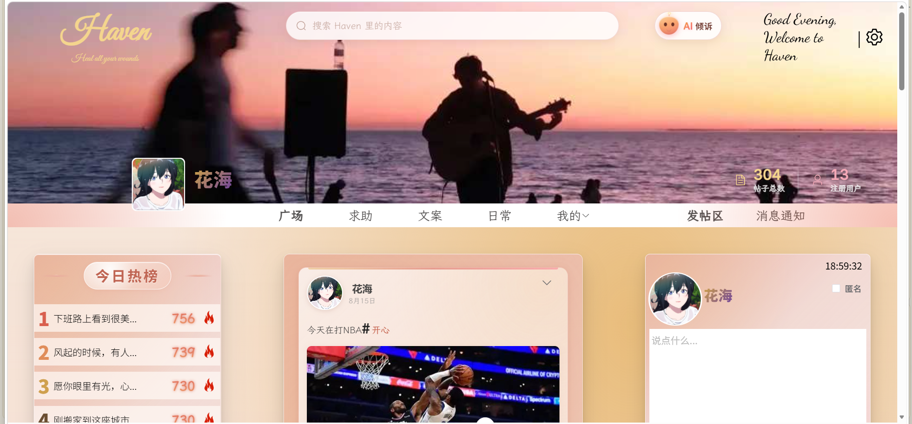
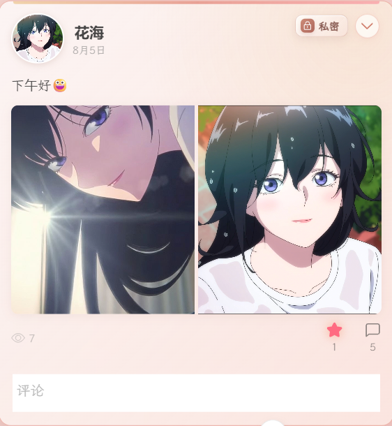
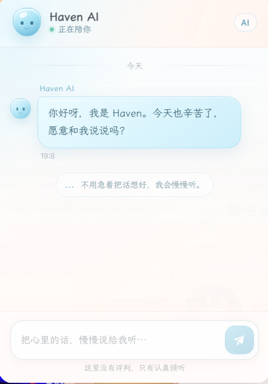

<div align="center">

# Haven

**Heal all your wounds**

一个面向 C 端的情绪倾诉社区：让每一个在意别人眼光的人，都能大胆开口。

[](https://vuejs.org)
[](https://www.typescriptlang.org)
[](https://vite.dev)
[](https://expressjs.com)
[](https://www.mysql.com)
[](https://github.com/11kyrie-star/haven-healing-you-all-/actions/workflows/ci.yml)

[项目简介](#项目简介) · [功能特性](#功能特性) · [快速开始](#快速开始) · [项目结构](#项目结构)

</div>

## 项目简介

Haven 是一个前后端分离的情绪社区。用户可以匿名或实名发布动态，在广场、求助、文案、日常四个板块浏览内容，通过点赞、评论、留言和实时通知产生互动，用户是无法进行相互关注等操作的，也无法看到对方的相关信息，旨在让用户能够畅所欲言；内置的 AI 树洞以流式对话的方式接住用户的情绪。

前端使用 Vue 3 + TypeScript + Vite + Pinia，后端使用 Express + MySQL，鉴权基于 JWT，实时通知走 WebSocket，AI 对话基于 SSE 流式返回。




## 功能特性

### 账号与资料

- 注册、登录、找回密码、封禁申诉
- 修改头像、昵称、邮箱、密码与个人简介
- 头像上传前自动压缩，减少传输体积

### 内容社区

- 广场 / 求助 / 文案 / 日常 四类信息流
- 发布图文动态，支持多图、标签、匿名发布、公开或私密
- 帖子编辑、删除、可见性切换、浏览量统计
- 帖子详情、评论与二级回复、评论点赞

### 发现与互动

- 关键词搜索：搜索历史、热门搜索、输入联想
- 今日热榜 Top 10，按热度值实时排序
- 点赞 / 取消点赞，我的帖子、我的评论、我赞过的
- 留言板：我和 TA 的留言往来

### 实时通知

- 点赞、评论、回复、留言、帖子下架、举报处理结果
- 未读数统计、单条已读、全部已读、清空通知
- WebSocket 实时推送，断线自动重连

### AI 树洞

- 基于大模型的流式对话，逐字返回
- 支持中途停止生成，只携带已完成的历史消息
- 内置倾听者人格提示词，不做诊断、不说教

### 内容治理

- 敏感词过滤、帖子举报、审核状态流转
- 有专门的B端做账号封禁与到期自动解封，封禁后 token 立即失效

## 技术栈

| 层级 | 技术 |
| --- | --- |
| 前端 | Vue 3、TypeScript、Vite、Element Plus、VueUse |
| 状态与路由 | Pinia（持久化）、Vue Router |
| 请求与安全 | Axios、DOMPurify |
| 后端 | Node.js、Express 5、MySQL、JWT、Joi、Multer |
| 实时能力 | WebSocket（通知）、SSE（AI 流式对话） |
| 工程化 | ESLint、Prettier、Oxlint、unplugin 自动导入、GitHub Actions CI |

## 快速开始

### 环境要求

- Node.js >= 18（前端建议 22.18+）
- MySQL >= 8
- pnpm（前端）/ npm（后端）

### 1. 克隆项目

```bash
git clone https://github.com/<your-name>/Haven.git
cd Haven
```

### 2. 创建数据库

```sql
CREATE DATABASE `my-haven` DEFAULT CHARSET utf8mb4;
```

### 3. 启动后端

```bash
cd backend
cp .env.example .env    # Windows 用 copy .env.example .env
npm install
npm run dev
```

按 `.env.example` 填写数据库、`JWT_SECRET`、`AI_API_KEY` 等配置。首次启动会自动建表。默认地址：`http://127.0.0.1:3007`，接口前缀 `/haven`。

### 4. 启动前端

```bash
cd frontend
npm install
npm run dev
```

浏览器打开 `http://localhost:5173`。前端环境变量见 `.env.development`：`VITE_API_BASE_URL` 指向后端接口，`VITE_WS_BASE_URL` 指向 WebSocket 服务。

> [!NOTE]
> AI 树洞需要配置 `AI_API_KEY`，未配置时其他功能不受影响。

> [!TIP]
> 生产环境前端把 `VITE_API_BASE_URL` 设为 `/haven`、`VITE_WS_BASE_URL` 留空，由 Nginx 同源反向代理 `/haven` 与 `/ws`。

<details>
<summary>环境变量说明</summary>

| 变量 | 说明 |
| --- | --- |
| `PORT` | 后端端口，默认 3007 |
| `SERVER_URL` | 对外地址，用于拼接图片与 WebSocket 地址 |
| `CORS_ORIGINS` | 允许跨域的前端地址，逗号分隔 |
| `DB_HOST` / `DB_PORT` / `DB_USER` / `DB_PASSWORD` / `DB_NAME` | MySQL 连接配置 |
| `JWT_SECRET` | JWT 签名密钥，必填 |
| `AI_API_KEY` / `AI_BASE_URL` / `AI_MODEL` | 大模型配置，兼容 OpenAI 协议 |

</details>

## 项目结构

```text
Haven/
├── .github/workflows/ci.yml   # CI：前端检查 + 后端语法检查
├── frontend/                  # C 端（Vue 3 + TypeScript）
│   ├── src/
│   │   ├── api/               # 接口封装
│   │   ├── components/        # 通用组件
│   │   ├── composables/       # 信息流、点赞、评论加载逻辑
│   │   ├── router/            # 路由与登录守卫
│   │   ├── stores/            # Pinia 状态
│   │   ├── styles/            # 设计令牌与全局样式
│   │   ├── utils/             # 请求、WebSocket、SSE、图片压缩
│   │   └── views/             # 页面
│   └── .env.development
├── backend/                   # Express + MySQL
│   ├── router/                # 路由定义
│   ├── handle_router/         # 业务处理
│   ├── schema/                # 参数校验
│   ├── middleware/            # 鉴权与校验中间件
│   ├── db/                    # 数据库连接池
│   ├── uploads/               # 头像与帖子图片
│   ├── migrate.sql            # 基础建表脚本
│   ├── migrate_auto.js        # 启动时补齐字段与辅助表
│   ├── notify.js              # 通知落库 + WebSocket 推送
│   ├── ai.js                  # 大模型流式调用
│   └── app.js
├── docs/images/               # README 截图
└── README.md
```

## 主要接口

| 方法 | 路径 | 说明 |
| --- | --- | --- |
| POST | `/haven/login` | 登录 |
| POST | `/haven/register` | 注册 |
| GET | `/haven/post/list` | 广场信息流 |
| POST | `/haven/post/create` | 发布帖子 |
| GET | `/haven/post/detail/:id` | 帖子详情 |
| POST | `/haven/post/:id/like` | 点赞 |
| POST | `/haven/comment/create` | 发表评论 |
| GET | `/haven/notification/list` | 通知列表 |
| POST | `/haven/ai/chat` | AI 流式对话（SSE） |

除登录、注册等公开接口外，均需在请求头携带 `Authorization: Bearer <token>`。

## 页面预览

| 登录 | 广场 |
| --- | --- |
|  |  |

| 帖子详情 | AI 树洞 |
| --- | --- |
|  |  |

## License

本项目仅用于学习与作品展示。
